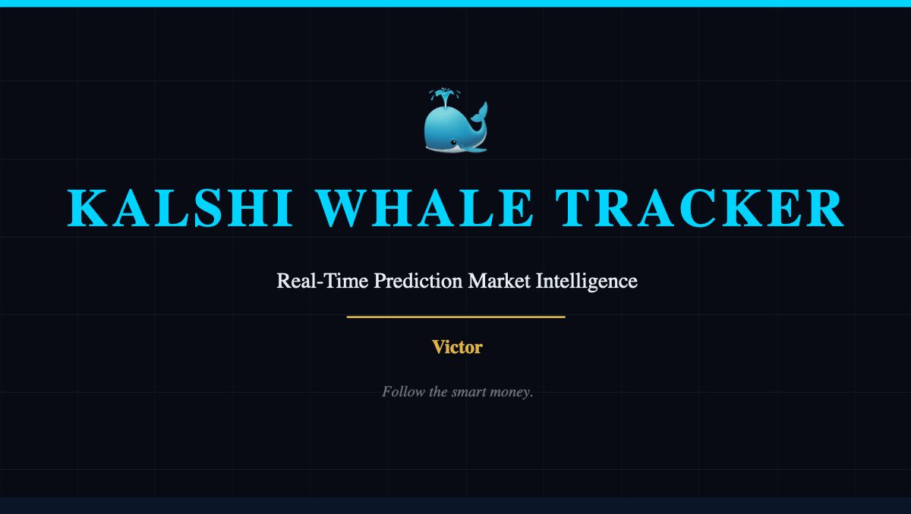
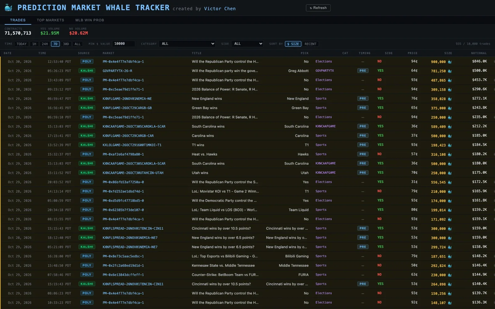
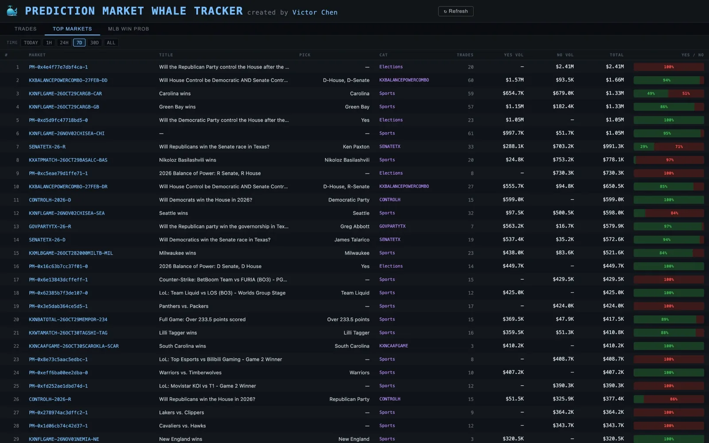
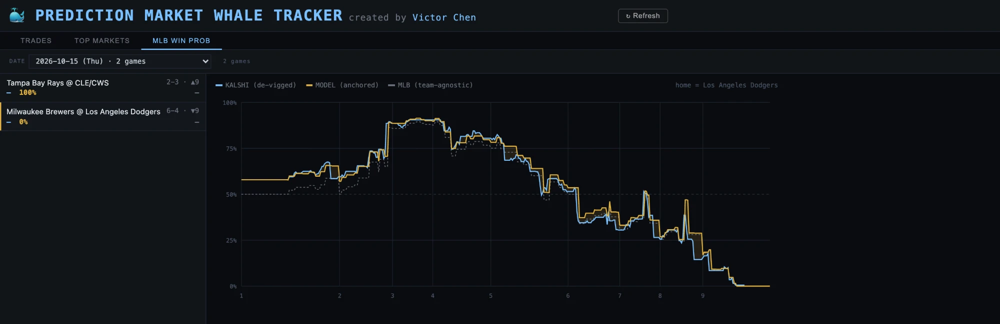

A live, full-stack web application that monitors large trades ("whale" trades) across prediction market exchanges in real time. The dashboard streams trades from Kalshi and Polymarket, filtering for high-value activity to surface where the smart money is moving.

<a href="https://pmwhaletracker.com" target="_blank" rel="noopener">View the live site at pmwhaletracker.com</a>

### Screenshots

**Trades:** large trades from Kalshi and Polymarket, filterable by time range, minimum dollar value, category, and side, and sortable by size or recency.

**Top Markets:** markets ranked by total whale volume over the selected time range, with the YES/NO split for each.

**MLB Win Prob:** a game's Kalshi price (de-vigged) plotted inning by inning against a win-probability model and a team-agnostic MLB baseline.

### Features

- **Real-time trade streaming** via WebSocket connection to Kalshi and REST polling for Polymarket
- **Whale detection** filtering trades by notional value (minimum $10K) and meaningful price signals
- **Category classification** across 50+ market types including Sports, Politics, Crypto, Economics, and Weather
- **Top Markets aggregation** showing the highest-volume markets across both exchanges
- **Live filters** for time range, minimum trade size, category, and side (YES/NO)
- **Dark terminal-style UI** designed for at-a-glance monitoring
- **ESPN integration** for real-time sports game start times linked to prediction markets
- **Auto-trader module** that copies whale trades based on configurable filters with stop-loss protection

### Architecture

The application uses a two-process monorepo architecture:

**Server (Node.js + Fastify)**
- Connects to Kalshi via WebSocket with RSA-PSS authentication
- Polls Polymarket via REST API for trade data
- Normalizes trades from both sources into a unified format
- Stores trade history in SQLite (WAL mode) with 6GB+ of historical data
- Broadcasts filtered whale trades to connected browser clients

**Client (Vite + React)**
- Real-time WebSocket connection for live trade updates
- Three main views: Trades feed, Top Markets aggregation, and MLB win probability charts
- Responsive dark theme with CSS custom properties
- Sortable columns by size, recency, and notional value

### Tech Stack

| Layer | Technology |
|-------|-----------|
| Frontend | React, Vite, CSS |
| Backend | Node.js, Fastify, WebSocket |
| Database | SQLite (better-sqlite3) |
| APIs | Kalshi WebSocket & REST, Polymarket REST, ESPN Scoreboard |
| Auth | RSA-PSS request signing |
| Deployment | PM2, Nginx |
| Notifications | Resend (email alerts) |
