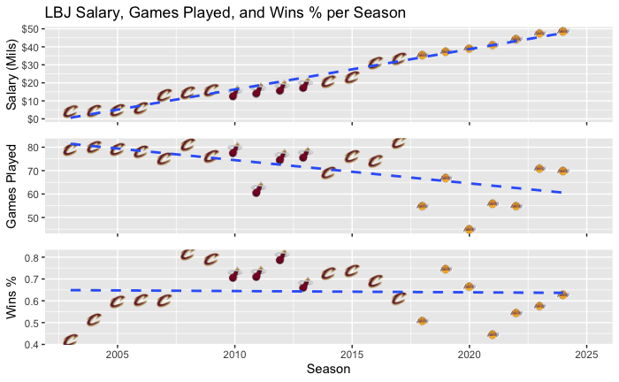
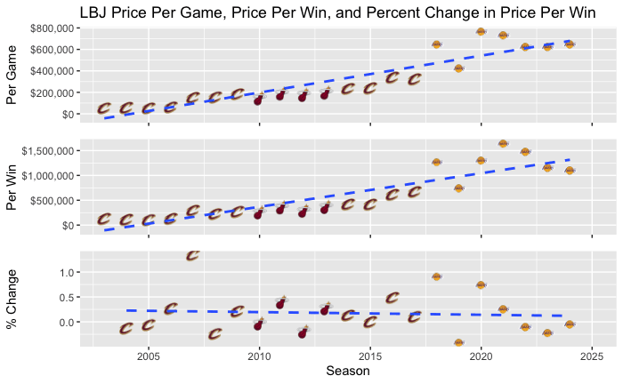
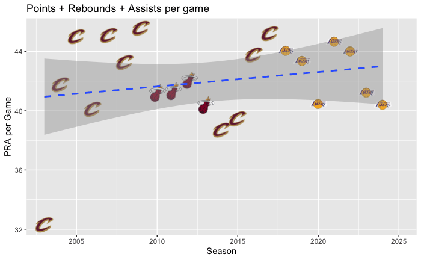
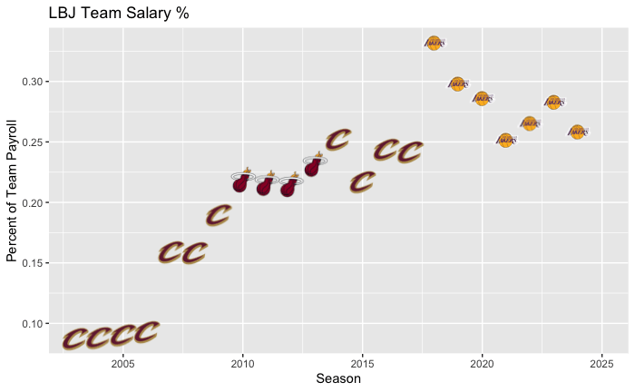

## Salary vs. games played and wins

Taking a look at his NBA career earnings, LBJ has been paid a grand total of $531,322,773 pre-tax (not including playoff bonuses) with his yearly salary increasing every season. According to Basketball-Reference, the Chosen One is set to earn over $52 million next season. But if we take a look and compare his salary to the number of regular season games played and win percentage of those games, we can see that LBJ might not be worth his contract on the court. The number of games played is in decline while his win percentage in games played seems to be consistent over his career at about .642.

## Price per game and per win

Besides the extrinsic value LBJ provides off court, and the NBA salary cap and contracts increasing each year, the numbers say that teams are paying more per game and each win each year LBJ plays. Are we all witnesses to the decline of King James? Comparing the year-to-year percent change in price per win, LBJ has been negative the last 3 years, which is a good thing, while overall it has a negative trend.

## Production when he plays

Don't get me wrong, if we are looking at individual statistics, LBJ has remained steady on his points + total rebounds + assists per game when he plays.

## Share of team payroll

But if NBA basketball is a team sport, should LBJ command such a high percentage of team payroll while not winning championships? It does look like when LBJ has a lower payroll share of 25% or below, his teams have won NBA championships (excluding the bubble title, which I believe should not count).

## Verdict

Overall, I believe LBJ is a great player, but I believe he commands too much of the team salary cap, and team wins have decreased while his career stats remain steady. Should the Lakers trade LeBron? When a player takes up so much salary cap, I believe there is no room for error when selecting role players that will fit the team's goals and strategy. Also, with the trade for Luka Dončić, who is in the prime of his career and taking up an additional $46 million in cap space, the Lakers need to trade LeBron.

## References

- LeBron James stats, height, weight, position, draft status and more. Basketball-Reference. (n.d.). <https://www.basketball-reference.com/players/j/jamesle01.html>
- NBA CBAs & cap history. Spotrac. (n.d.). <https://www.spotrac.com/nba/cba>
